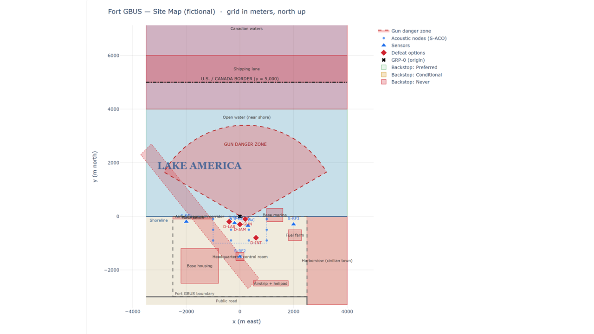

# Fort GBUS Counter-Drone Decision Aid

*GBUS 562 capstone. Everything here is made up or public: Fort GBUS is a fictional base, and the
sensors, rules, and events are invented for this project. The weather comes from a public National
Weather Service forecast.*

## What It Does

When an unknown drone appears near a military base, the counter-drone operator has only minutes to
combine sensor readings that often disagree, decide what the drone is and how dangerous it is, and
check the rules of engagement, today's notices, the weather, equipment health, and what lies behind
the target. Only then can they choose the least force that works safely, or no force at all. That is
too much for one person under time pressure, and mistakes go both ways: missing a real threat, or
using force when it is unsafe, unlawful, or unnecessary.

This tool is a decision aid for that operator and for the control room, where the person in charge
of the watch has final authority. For each drone event it runs a fixed team of Claude agents. An
**analyst** reads the sensors, weather, equipment health, notices, and site map through MCP tools,
searches the base's rules (RAG), rates the threat, and recommends a response from a seven-rung
escalation ladder (from "monitor" up to the gun), listing the options that are blocked and why. A **reviewer** checks that
recommendation on its own and can turn it into DO NOT ENGAGE. The **operator** accepts, rejects, or
overrides it (an override needs a written reason). Any request for force (the RF jammer or
above) and any override then goes to the **control room**, advised by a **safety agent**, and only
a person there can approve it or stop it.

**The tool recommends; people decide.** It never fires, controls, or points anything.

## Demo

**Demo video:** *coming soon (a 3–5 minute narrated screen recording of the tool at work).*

The site map below is drawn by the tool from a made-up grid, not from real map imagery. It shows
the sensors, the defeat options, the gun's danger zone over the lake, the U.S.–Canada border, and
the "backstop" areas (what lies behind a target) where force is preferred, conditional, or never
allowed.

## How to Run

On Windows with Python 3.13 installed, double-click [`capstone/run.bat`](run.bat).

It installs the packages, builds the rules database, and opens the web page. From the page you
can replay past runs or start a new one. Dry runs are free. Real runs call Claude and need an
Anthropic API key saved in `API-Key.txt` in the folder above the repository.
