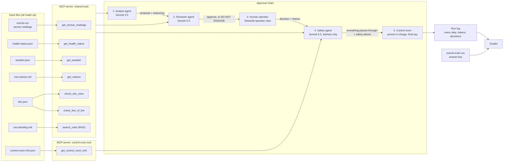

# Capstone Project Brief: Fort GBUS Counter-Drone Decision Aid

*Draft 6 — working document. Updated with the decisions from the brainstorming session.*

## 1. The business problem

Fort GBUS, a fictional military installation on the shore of Lake America (formerly Lake
Ontario), has a counter-drone system with five kinds of sensors and four kinds of defeat
options. When a drone shows up, an operator has minutes or less to:

- combine readings from sensors that report at different times and often disagree,
- decide what the object is and how threatening it is,
- check the rules of engagement, today's time-based notices, the weather, the health of
  every sensor and defeat option, and what lies behind and below the target,
- and choose the **least force that works safely**, or no force at all.

That is too much to hold in one person's head under time pressure. Mistakes go both ways:
missing a real threat, or using force when it is unsafe, unlawful, or unnecessary.

## 2. The tool: one useful job

**Given one drone event, produce a reviewed recommendation that human operators can approve,
override, or stop.** The tool:

1. reads the sensor readings, weather, equipment health, rules, notices, and site map for
   that event,
2. builds a picture of each track (what it is, where it is, how confident we are),
3. rates the threat,
4. recommends a response and lists the options that are **blocked and why**, with rule
   citations,
5. has the recommendation checked by independent reviewer agents,
6. shows it all on an operator display and a control-room display.

**The tool recommends; humans decide.** It never fires, controls, or points anything.

**Who uses it:** the counter-drone watch operator, and the control room (the person in
charge of the watch), which has final authority and is responsible for every action
(ROE-1.8).

## 3. The setting (fictional base, real lake)

- **Base:** Fort GBUS (fictional), on the U.S. shore of Lake America.
- **Shoreline layout (made-up, generic):** lakeshore and beach, base housing, fuel farm,
  marina, shipping lane offshore, airfield approach path, public road / town edge.
- **The international border:** the U.S.–Canada border runs through the lake. A pilot on a
  boat across the line can't simply be picked up by base security or the U.S. Coast Guard;
  it becomes a coordination and notification problem.
- **Season:** late fall. Event week **Mon Nov 30 – Sat Dec 5, 2026.** No swimmers; beach
  mostly empty except occasional walkers; a few hardy boaters; shipping still active.
- **Lake conditions that matter:** lake-effect snow, gales, fog, low-sun glare off the water,
  wind and waves, long nights (sunset about 16:35), thermal crossover at dawn and dusk.
- **Weather source:** the public National Weather Service forecast or observations for
  **Rochester, NY** (reference station), adjusted where an event needs it and marked as such.
- **Layout:** see `inputs/site.md`. The map is drawn in the app from the site grid, not from
  real map imagery, so the base doesn't match any real place.

## 4. Sensors (generic, made-up capabilities)

| Sensor | What it adds | Where it's weak |
|---|---|---|
| RF detection / demodulation | Drone protocol or model, controller link, sometimes pilot location | Silent against a drone flying preset waypoints with no live link |
| Radar | Bearing and range, early detection | Sea clutter from waves; birds; small, slow targets |
| Distributed acoustic array (~2 km²) | Independent position fix; rotors vs. aircraft | Wind, surf, boat engines; limited range |
| Gimbal camera (IR / visible / high-speed) | Confirms what the object is; blade spin rules out birds; IR at night | Narrow view, must be pointed by another sensor; fog and haze |
| Wide-area scanning camera | Continuous sky watch; finds RF-silent targets | Low resolution: detects, doesn't identify |

Typical chain: wide-area camera or radar detects → gimbal camera is pointed and confirms →
RF identifies and finds the pilot → acoustic array backs up the position.

## 5. Defeat options and their "never" conditions

| Option | Best used when | Never / blocked when |
|---|---|---|
| RF jammer | Drone on a live controller link | Drone is RF-silent (won't work); interference risk to ship radio, GPS, aircraft, or base systems |
| Interceptor drone | Other options unsafe, e.g. populated area behind target | Conflict with the base's own aircraft; debris over people |
| Laser on remote gimbal | Clear line of sight, good visibility | Above the **elevation-angle limit** (satellite protection); inside a **satellite-pass window**; aircraft nearby; people or crews in the beam path; fog, haze, spray; no safe backstop |
| Gun on remote gimbal | Last resort, close in, others failed or unavailable | No safe backstop (rounds and debris must fall into open water, never toward housing, fuel farm, shipping lane, or town) |

Every option is also blocked if it is **down for maintenance** in the health-status file.

## 6. Escalation ladder

| Rung | Action | Approval needed |
|---|---|---|
| 0 | Monitor / track | Automatic |
| 1 | Point camera, identify, alert | Automatic |
| 2 | Warn, send security to pilot, notify Coast Guard | Operator |
| 3 | RF jammer | Operator + control room |
| 4 | Interceptor drone | Control room |
| 5 | Laser | Control room |
| 6 | Gun | Control room |

Use the **least force that works**; step up only when needed.

## 7. Approval chain

```
 Inputs (via MCP tools)
          │
          ▼
 1. ANALYST agent ─────────── proposes a response, with reasoning and citations
          │
          ▼
 2. REVIEWER agent ────────── approves or rejects the proposal
          │                   (reject → recommendation becomes "DO NOT ENGAGE")
          ▼
 3. HUMAN OPERATOR ────────── approve / reject / override
          │
          ▼
 4. SAFETY agent ──────────── reviews the operator's decision, adds advice;
          │                   advises only: everything passes through unchanged
          ▼
 5. CONTROL ROOM ──────────── person in charge of the watch; final say;
                              can STOP an engagement; responsible for every action
```

**Rules for the chain:**

- **Reviewers see everything.** The reviewer and the control-room safety agent get all the
  inputs **plus** the analyst's full reasoning. To keep their reviews independent, their
  instructions tell them to **work through the checks on their own first** (rules → notices
  → weather → health → backstop), then compare with the analyst and note any differences.
- **Reviewer reject:** no redraft. The operator's recommendation becomes **"DO NOT
  ENGAGE,"** shown with the reviewer's reasons and the analyst's original proposal.
- **Operator override:** the operator can override a "do not engage" deliberately, using a
  separate button: **"OVERRIDE REVIEWER REJECT — ENGAGE DRONE."**
  - A **written reason is required**; the button won't submit without one. It goes in the
    run log.
  - The request reaches the control room marked **"OPERATOR OVERRODE REVIEWER,"** with the
    reviewer's reasons and the operator's reason side by side. The safety agent sees all of
    it.
  - An override **can't skip rungs.** It only sends the request up; for the jammer and above,
    the control room must still approve.
- **Control room:** can **stop** an engagement when it has better information (for example,
  eyes on the target area, or friendly aircraft inbound). It can't step up an engagement the
  operator rejected.
- **The safety agent only advises (ROE-4.5).** It never approves, blocks, or changes
  anything; the control room decides.
  - **Advice goes forward only:** it may use control-room-only information, so its advice
    goes to the control room, never back to the operator.
  - **Failure passes through:** if it fails or times out, the operator's request still
    reaches the control room, marked **NO SAFETY ADVICE AVAILABLE**, and still needs
    control-room approval.
- **Silence means no.** If the control room doesn't respond in time, no defeat action is
  taken.
- **Accountability (ROE-1.8).** The control room, meaning the person in charge of the watch,
  is the final authority and is responsible for every action taken through this process.
  Responsibility can never be handed to a tool. The run log records who decided what, and
  why.

**Five layers of safety (defense in depth, ROE-1.9).** No single check has to be perfect;
each can catch what the one before it missed, and each fails safe.

| Layer | Who | What makes it independent | How it fails safe |
|---|---|---|---|
| 1. Analyst | Claude agent | Works through every rule and cites them | Must list blocked options with reasons |
| 2. Reviewer | Claude agent | Separate instructions; checks on its own first | Reject → DO NOT ENGAGE |
| 3. Operator | Person | Human judgment | Override needs a written reason and still goes up |
| 4. Safety agent | Claude agent | Extra, control-room-only information | Failure passes through, flagged; still needs approval |
| 5. Control room | Person | Final authority, best information | Silence means no; can stop any engagement |

*Caveat:* layers 1, 2, and 4 run on the same model, so they may share blind spots
(common-mode failure). Different instructions and different information reduce this; the
two human layers provide the most independent checking. The run log should show at least
one case of a later layer catching an earlier one (event 07 is designed to).

## 8. Input files (all made-up)

```
inputs/
├── site.md                   <- Fort GBUS layout, zones, border, sensor + defeat positions
├── site.json                 <- same layout as numbers (map drawing, distance checks)
├── roe-standing.md           <- standing rules with citable IDs (ROE-x.y)
├── roe-notices.md            <- time-based notices (N-xx): satellite windows, own drone
│                                flights, airfield, regatta, shipping, alert levels
├── weather.json              <- conditions for each event (from the Rochester NWS forecast)
├── health-status.json        <- readiness by time for each sensor and defeat option (H-xx)
├── control-room-info.json    <- info only the control room sees (C-xx)
├── events.csv                <- sensor readings: all 10 events, 7 steps each, 29 columns
├── events-columns.md         <- data dictionary for events.csv
└── events-truth.csv          <- answer key; never given to the agents

scripts/
├── make_events.py            <- SOURCE for events.csv and events-truth.csv
└── site_map.py               <- draws the Fort GBUS map from site.json

maps/
└── fort-gbus-map.html        <- interactive site map
```

Possible public sources to add to the rules material (summarized, cited):
10 U.S.C. § 130i (counter-drone authority on certain military facilities), DoD Directive
3000.09 (human judgment over the use of force), FAA Remote ID, the DoD Laser Clearinghouse
concept of satellite-pass avoidance windows.

## 9. Ten events over one week (draft 3: Mon Nov 30 – Sat Dec 5, 2026)

Event times and conditions may shift to fit the real Rochester forecast (approach A).

| # | When | Scenario | What the tool must get right |
|---|---|---|---|
| 01 | Mon Nov 30, 10:15 | Hobby quadcopter on a live link, over water | Straightforward: track, warn, jammer allowed |
| 02 | Mon Nov 30, 16:30 | Gull flock at sunset; radar + wide-area camera alarm | High-speed camera shows no blade spin → not a drone |
| 03 | Tue Dec 1, 06:42 | Pre-dawn fog; drone toward fuel farm; laser down for maintenance | Laser unavailable *and* weather-blocked; pick next safe option |
| 04 | Tue Dec 1, 14:05 | Drone with valid Remote ID on the base's own flight schedule | Friendly: no defeat action |
| 05 | Wed Dec 2, 11:30 | RF-silent drone flying preset waypoints | Must not recommend the jammer; "no RF ≠ no drone" |
| 06 | Wed Dec 2, 21:10 | Night, drone over base housing | Gun blocked (no backstop); interceptor or jammer instead |
| 07 | Thu Dec 3, 08:20 | Radar and acoustic fixes 300 m apart; acoustic degraded. RF locates the pilot on the beach (everyone sees it). Reviewer says "do not engage"; operator overrides. | Control room, with the patrol's eyes-on report of walkers on the beach, connects the pilot to the walkers, **stops the engagement**, and **sends law enforcement (base security) to detain the pilot**: least force that works |
| 08 | Thu Dec 3, 16:50 | Drone at steep elevation during a satellite-pass window, just after sunset | Laser blocked twice over; choose another option |
| 09 | Fri Dec 4, 12:00 | Drone launched from a boat; pilot location across the border | Notify U.S. Coast Guard and coordinate across the border; jammer near shipping lane needs care |
| 10 | Sat Dec 5, 15:30 | Two drones at once during the **frostbite regatta**; jammer faults mid-event; friendly helicopter inbound | Prioritize; re-plan when equipment changes; control room stops an engagement for the helicopter |

## 10. Course techniques

| Technique | Role in the tool |
|---|---|
| Prompt engineering | Structured output for each agent: threat assessment, recommendation, reasons, citations, verdicts |
| RAG | Retrieve the relevant standing rules and public law, with citations |
| Agent + MCP server | An MCP server exposes the inputs as tools (sensor readings, health, notices, weather, site zones, line of fire, rule search). Agents call them as needed. The control-room info tool is available **only** to the safety agent. **check_line_of_fire** does the geometry in code (bearing, elevation angle, distance, sector, zones beyond the target), because language models are unreliable at trigonometry; this makes the laser elevation limit and gun backstop checks exact. |
| Team | Analyst → reviewer → (operator) → safety agent → (control room), each agent with its own instructions |

**Model:** Claude Sonnet 5.5 (`claude-sonnet-5-5`) for all agents.

**Architecture:**



The analyst and reviewer can reach only the shared tools. The control-room tool is wired
**only** to the safety agent. The answer key goes **only** to the grader, never to an agent.

**Workflow type: a pipeline, not an orchestrator.**

In one line: *a sequential, human-in-the-loop pipeline of tool-using agents, run at each
time step.*

| | Pipeline (prompt chaining) | Orchestrated (orchestrator–workers) |
|---|---|---|
| Who decides what happens next? | **Code.** The order of stages is fixed in advance. | **An AI orchestrator** decides at run time which workers to call, in what order, how often. |
| Path through the system | The same every time, apart from branches written in code | Can differ from run to run |
| Good for | Known steps where **the order matters** | Open-ended tasks with unpredictable subtasks |

How Fort GBUS fits:

- **Outer flow: a fixed pipeline with approval gates.** Every recommendation goes analyst →
  reviewer → operator → safety agent → control room. No AI decides whether to call the
  reviewer or skip the safety agent.
- **Branches are written in code, not chosen by a model:** reject → DO NOT ENGAGE; override →
  flagged request; safety-agent failure → pass through flagged; silence → no.
- **Inside each stage, the agents are agentic:** each decides which MCP tools to call and in
  what order (the tool-use loop from Week 4).
- **Around it all, a time loop:** in step-by-step mode the pipeline runs once per batch of
  readings.
- **Pattern names** (from Anthropic's "Building effective agents"): *prompt chaining with
  gates*, plus an *evaluator* (the reviewer) **without** the optimizer loop, since there is no
  redraft. It is deliberately **not** orchestrator–workers.

**Why a pipeline:** for a safety-critical decision, the order of checks must be fixed,
predictable, and auditable. An orchestrator could, on some run, decide that the reviewer or
the safety agent "isn't needed this time." A pipeline can't. That guarantee is what makes
the five layers of safety and the accountability rule (ROE-1.8) believable: every action
provably went through every check, and the run log shows it.

**Processing mode:**

- **Phase 1: step-by-step.** The tool steps through each event as readings arrive, updating
  the picture and recommendation at each step. **Every step is kept in the run log** (inputs
  at that moment, each agent's output, tokens used).
- **Phase 2: one pass.** Once we are satisfied with the workflow, switch to processing the
  whole event in one pass. The step-by-step runs stay in the log.
- **To settle later:** what counts as a "step" (every new reading, a fixed time window, or
  only significant changes), and whether the reviewer runs at every step or only when the
  analyst's recommendation changes.
- **Cost note:** step-by-step costs roughly (number of steps) × a single pass. The log will
  let the business case compare the two modes.

## 11. Front end (Streamlit)

**Operator view**
- **Header:** Fort GBUS, event number, date/time, weather, active notices.
- **Map:** shoreline, border, zones, sensor and defeat-option positions, drone track, pilot
  location if known; replay slider to step through the timestamped readings.
- **System status board:** green / yellow / red for every sensor and defeat option.
- **Threat and recommendation panel:** classification, threat level, confidence; recommended
  response; **blocked options with reasons**; reviewer verdict with rule citations.
- **Buttons:** Approve / Reject; and, when the reviewer said "do not engage," a separate,
  distinct **"OVERRIDE REVIEWER REJECT — ENGAGE DRONE"** button with a required reason box.

**Control room view**
- Everything the operator saw, plus the operator's decision (and override reason, if any).
- Control-room-only information for that time.
- Safety agent's advice.
- **Buttons:** Approve / Stop (with reason). No response = no engagement.

**Replay from log:** reopen any saved run without calling the API (for the demo video).

## 12. Deliverables (from the professor)

| Deliverable | Plan |
|---|---|
| Tool + run log of 10+ real runs | One run per event, logged automatically: inputs, each agent's output, model, tokens, time, operator and control-room decisions, override reasons |
| Business case: users, cost per run and per month | Token counts from the log → cost per run (three Sonnet 5.5 agents per event), step-by-step vs. one-pass; estimate monthly volume for a base |
| A failure found and fixed, shown in the run log | Expected from the tricky events (05, 06, 07, 08, 10) or a reviewer rubber-stamping a bad proposal; log shows bad run → fix → good re-run |
| Project page + 3–5 min narrated demo video | GitHub Pages page; video recorded with Snipping Tool, edited in Clipchamp, hosted on YouTube (unlisted) |

## 13. Guardrails

- **Public repo:** made-up or public data only. No real product names, ranges, frequencies,
  power levels, performance numbers, or procedures from former work. Defeat options stay as
  generic categories with made-up rules. Shoreline layout is generic, not a real stretch of
  coast.
- **Humans in the loop:** the tool only recommends; agents never override humans.
- **Accountability:** the control room (the person in charge of the watch) is responsible
  for every action taken through this process; responsibility can never be handed to a
  tool (ROE-1.8).
- **API key:** loaded at run time from the environment; never in code, logs, the page, or
  the video.
- **Video:** clean screen; nothing showing key files, environment variables, or real material.

## 14. Timeline

| Milestone | Target |
|---|---|
| Brainstorm and brief (this sandbox folder) | Now – Nov 25 |
| Brief goes to GitHub | ~Wed Nov 25, 2026 |
| Finished product goes to GitHub | ~Wed Dec 9, 2026 |

## 15. Work in progress

| Item | Owner | Status |
|---|---|---|
| Sensor reading fields (event file format) | Student (from prior-work experience, kept generic and made-up) | Drafting |
| Rules of engagement and notices contents | Student (made-up rules; public law summarized) | Drafting |
| Site description (`inputs/site.md`, `site.json`) and map | Claude Code | Done (border at y = 5,000) |
| Sensor readings + answer key (`make_events.py`) | Claude Code | Done: events 01–10 |
| Rules (`roe-standing.md`, `roe-notices.md`) | Claude Code, student reviewing | Draft 1 + PVID rules |
| Health status, control-room info, data dictionary | Claude Code | Draft 1 |
| Weather (`inputs/weather.json`) from the Rochester NWS forecast | Claude Code, on request | Waiting for the forecast (available ~Nov 20–21) |
| Briefing deck (PowerPoint) | Claude Code starter, student polishes | Next |
| App skeleton (Streamlit) | Claude Code, on request | Not started |

## 16. Open questions

1. What counts as a "step" in step-by-step mode, and when the reviewer runs.
2. When exactly to move this folder into the GitHub repo (brief first, then the full product).
